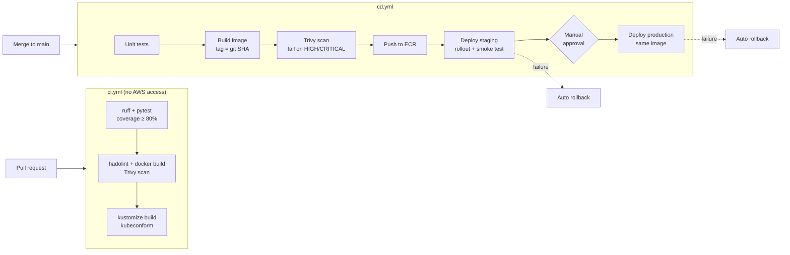

# CI/CD Pipeline Automation for Amazon EKS

[](https://github.com/Lifeofdrew2/eks-cicd-pipeline/actions/workflows/ci.yml) [](https://github.com/Lifeofdrew2/eks-cicd-pipeline/actions/workflows/cd.yml)

Automated build and deployment workflows using **GitHub Actions**, **Docker**,
**Amazon ECR** and **Amazon EKS**. Every change is tested, scanned, packaged
once as an immutable image, deployed to staging, verified, and promoted to
production after approval — with automatic rollback if anything fails.

**Technologies:** GitHub Actions · Docker · AWS (ECR, EKS, IAM OIDC) · Kubernetes · Kustomize · Trivy · CI/CD

> **About this repository.** An independent reference implementation written
> to demonstrate CI/CD practices for container workloads on EKS. It uses a
> synthetic sample application and contains no client code or data. It deploys
> to the cluster created by the companion **aws-eks-platform** repository.

---

## Pipeline



## What makes it safe

| Practice | How it is implemented |
|---|---|
| **No long-lived AWS keys** | GitHub OIDC → `sts:AssumeRoleWithWebIdentity`. The IAM trust policy only accepts `main` and the `staging`/`production` environments; pull requests get no AWS access. |
| **Least privilege** | The deploy role can push to one ECR repo, describe one cluster, and edit workloads only in `demo-staging` and `demo-production` (EKS access entries, namespace-scoped). |
| **Build once, deploy many** | One image per commit, tagged with the 7-char git SHA. Staging and production run the identical artifact. |
| **Immutable artifacts** | ECR tag immutability; the app reports its version so the smoke test proves the right build is live. |
| **Shift-left security** | hadolint on the Dockerfile; Trivy scans the image *before* it is pushed. |
| **Progressive delivery** | Rolling update with `maxUnavailable: 0`, readiness probes, staging gate, manual approval for production. |
| **Automatic rollback** | `scripts/deploy.sh` runs `kubectl rollout undo` if the rollout times out or the smoke test fails. |
| **Manual rollback** | `rollback.yml` redeploys any earlier SHA, or returns to the previous revision. |
| **Traceability** | Each revision carries a `kubernetes.io/change-cause` with the commit and workflow run. |
| **No overlapping deploys** | A shared `concurrency` group queues deployments rather than running them in parallel. |

## Repository layout

```
├── app/                          Sample FastAPI service, tests, Dockerfile
├── k8s/
│   ├── base/                     Deployment, Service, HPA, PDB, ServiceAccount
│   ├── overlays/staging/         2 replicas, smaller limits
│   ├── overlays/production/      3+ replicas, more headroom
│   └── namespaces.yaml           One-time bootstrap by a cluster admin
├── scripts/
│   ├── deploy.sh                 Apply, wait, smoke test, auto-rollback
│   └── smoke-test.sh             Health, API and version checks
├── infra/github-oidc/            Terraform: OIDC provider, IAM role, EKS access entry
├── .github/
│   ├── workflows/ci.yml          Pull request checks
│   ├── workflows/cd.yml          Build → staging → approval → production
│   ├── workflows/rollback.yml    Manual rollback
│   └── actions/setup-k8s-tools/  Composite action: pinned kustomize + kubeconform
└── docs/                         Setup guide, rollback runbook, validation results
```

## Getting started

See **[docs/setup.md](docs/setup.md)** — about 15 minutes once the EKS cluster
from `aws-eks-platform` exists.

Run the checks locally without AWS:

```bash
cd app && pip install -r requirements-dev.txt && ruff check . && pytest --cov=main
for env in staging production; do kustomize build k8s/overlays/$env | kubeconform -strict -summary -; done
```

## Documentation

- [Setup guide](docs/setup.md)
- [Rollback runbook](docs/rollback-runbook.md)
- [Validation results](docs/validation.md)
